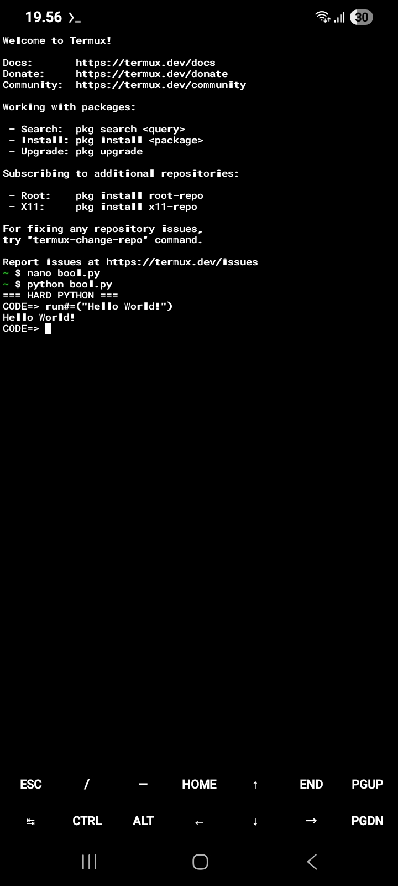

# Hard-Python
The first interpreter architecture (bool.py), mapping tables for syntax functions and modules, and sample scripts for a custom Python-based programming language specifically designed to run on mobile devices (e.g., via Termux).
# 1.What is HARD PYTHON, bool.py and index.hp
Hard Python is a custom language based with normal python, bool.py is abbreviation from base of own language.python, index.hp has meaning index(file name).hp (hard python).
# 2.Syntax Summary & Mapping
This language uses custom syntax mappings with = and #= suffixes to distinguish built-in functions and standard modules from standard Python syntax.

A. Built-in Function Mapping

print()➡️ 
run#= 
🟰Displays output to the screen. 
run#=("Hello World")
len()➡️ 
countelment#= 
🟰Counts element length or character count.
countelment#=([1, 2, 3])
type()➡️
unignovar#= 
🟰Checks the variable data type. 
unignovar#=(10)
range()➡️
sortnum#=
🟰Generates a sequence of numbers
sortnum#=(5)
input()➡️
wrtsmtng#=
🟰Prompts for user string input
wrtsmtng#=("Enter name: ")
int()➡️
cntrl#=
🟰Converts a value to an Integer
cntrl#=("100")
str()➡️
wire#=
🟰Converts a value to a String
wire#=(500)
float()➡️
des#=
🟰Converts a value to a Float
des#=("3.14")
sum()➡️
calculate#=
🟰Sums all elements in a list/iterable
calculate#=([1, 2, 3])
max()➡️
high#=
🟰Finds the highest value in a list
high#=([10, 50, 20])
min()➡️
low#=
🟰Finds the lowest value in a list
low#=([10, 50, 20])
sorted()➡️
arrangeall#=
🟰Sorts elements in a list
arrangeall#=([3, 1, 2])
abs()➡️
conpos#=
🟰Returns the absolute/positive value
conpos#=(-15)

B. Standard Module Mapping

os➡️
sd#=
🟰System operation interactions
sd.getcwd()
sys➡️
parac#=
🟰System arguments and parameters
parac.version
subprocess➡️
outshell#=
🟰Sub-process shell command execution
outshell.run(["ls"])
shutil➡️
dosmtngwthfl#=
🟰File and directory management
dosmtngwthfl.copy("a", "b")
pathlib➡️
maobmo#=
🟰Object-oriented filesystem path management
maobmo.Path(".")
glob➡️
sfwwc#=
🟰File pattern matching using wildcards
sfwwc.glob("*.py")
tempfile➡️
mfadfnp#=
🟰Temporary file and directory generation
mfadfnp.TemporaryFile()
platform➡️
infodevice#=
🟰Hardware architecture and platform details
infodevice.system()
ctypes➡️
cfcex#=
🟰External C library bindings
cfcex.CDLL(...)
signal➡️
riss#=
🟰OS interrupt signal handling
riss.SIGINT

# 3.Interpreter Architecture (bool.py)

The interpreter operates using Regular Expression (RegEx) transpilation to convert custom syntax into standard Python code before executing it in the Python runtime environment. It supports reading .hp script files and includes an interactive REPL mode featuring auto-evaluation for expressions.

code:

```python
import sys
import re

FUNCTION_MAP = {
    r'\brun#=': 'print',
    r'\bcountelment#=': 'len',
    r'\bunignovar#=': 'type',
    r'\bsortnum#=': 'range',
    r'\bwrtsmtng#=': 'input',
    r'\bcntrl#=': 'int',
    r'\bwire#=': 'str',
    r'\bdes#=': 'float',
    r'\bcalculate#=': 'sum',
    r'\bhigh#=': 'max',
    r'\blow#=': 'min',
    r'\barrangeall#=': 'sorted',
    r'\bconpos#=': 'abs',
}

MODULE_MAP = {
    r'\bsd#=': 'sd',
    r'\bparac#=': 'parac',
    r'\boutshell#=': 'outshell',
    r'\bdosmtngwthfl#=': 'dosmtngwthfl',
    r'\bmaobmo#=': 'maobmo',
    r'\bsfwwc#=': 'sfwwc',
    r'\bmfadfnp#=': 'mfadfnp',
    r'\binfodevice#=': 'infodevice',
    r'\bcfcex#=': 'cfcex',
    r'\briss#=': 'riss',
}

MODULE_IMPORTS = """
import os as sd
import sys as parac
import subprocess as outshell
import shutil as dosmtngwthfl
import pathlib as maobmo
import glob as sfwwc
import tempfile as mfadfnp
import platform as infodevice
import ctypes as cfcex
import signal as riss
"""

def translate_code(code):
    """Translate custom syntax into standard Python syntax."""
    translated = code
    for pattern, repl in FUNCTION_MAP.items():
        translated = re.sub(pattern, repl, translated)
    for pattern, repl in MODULE_MAP.items():
        translated = re.sub(pattern, repl, translated)
    return translated

def run_file(file_path):
    """Read and execute a custom script file."""
    try:
        with open(file_path, 'r', encoding='utf-8') as f:
            code = f.read()
        final_code = MODULE_IMPORTS + "\n" + translate_code(code)
        exec(final_code, {})
    except Exception as e:
        print(f"Runtime Error: {e}")

if __name__ == "__main__":
    if len(sys.argv) > 1:
        run_file(sys.argv[1])
    else:
        print("=== HARD PYTHON ===")
        print("Enter commands directly or type 'exit' to quit.\n")
        global_env = {}
        exec(MODULE_IMPORTS, global_env)
        
        while True:
            try:
                line = input("CODE=> ")
                if line.strip() == "exit":
                    break
                if not line.strip():
                    continue
                
                py_code = translate_code(line)
                
                # Automatically evaluate expressions so results appear directly in REPL
                try:
                    result = eval(py_code, global_env)
                    if result is not None:
                        print(result)
                except SyntaxError:
                    exec(py_code, global_env)
                    
            except Exception as e:
                print(f"Error: {e}")
```
# 4.How to Run on Mobile Devices (Termux)

1.Create the interpreter script (bool.py):
nano bool.py

2.Copy paste the code that is in interpreter architecture

3.Create your custom source script (index.hp):
nano index.hp

4.Execute the source file:
python bool.py index.hp

5.Launch the interactive REPL shell:
python bool.py


